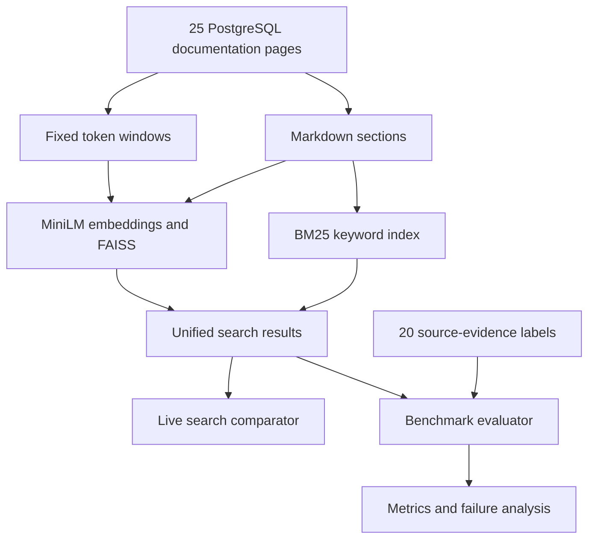

# SearchWorkbench

A Python application comparing BM25 keyword retrieval with dense semantic retrieval over PostgreSQL documentation. Includes live search, chunking comparisons, source-based relevance labels, automated metrics, tests, and an audit trail.

## Architecture



## Setup and commands

Requires Python 3.11–3.13. Use uv (lockfile included):

```bash
uv sync
uv run streamlit run src/app.py
uv run pytest -v
uv run python -m scripts.run_benchmark
```

Or use a virtual environment:

```bash
python3 -m venv .venv
source .venv/bin/activate
python -m pip install -e .
python -m streamlit run src/app.py
python -m pytest -v
python -m scripts.run_benchmark
```

On Windows, use `.venv\Scripts\activate`. First launch needs internet access to download the free local model and tokenizer data. No API key is needed. Model files are cached outside the project. Subsequent model loading may check the Hub for updates; for a fully offline run after caching, set `HF_HUB_OFFLINE=1`. Test-only deterministic checks: `python -m pytest -m "not integration" -v`. UI interaction checks: `python -m scripts.check_ui`.

Container option:

```bash
docker compose up --build
docker compose exec search python -m pytest -v
```

Open http://localhost:8501. Docker files are included but were not executed in the preparation environment, which did not have Docker. No hosted deployment has been created.

## Files

| File or folder | Purpose |
|---|---|
| `src/chunking.py` | Fixed token windows and fenced-code-aware Markdown sections |
| `src/indexer.py` | Shared tokenization, local embeddings, BM25 and FAISS |
| `src/search.py` | Same-corpus construction of four configurations |
| `src/benchmarker.py` | Evidence matching, metrics, latency measurement |
| `src/app.py` | Live search and benchmark dashboard |
| `corpus/` | 25 downloaded PostgreSQL 17 documentation pages |
| `data/corpus_manifest.json` | Original URLs, retrieval time, word counts, SHA-256 hashes |
| `data/eval_queries.json` | 20 labeled exact/conceptual queries |
| `reports/` | Measured results, environment, and verification logs |
| `audit/` | Archived drafts and exact fixes |
| `ai_prompt_log.md` | AI provenance, actual review findings, seeded regression examples |

## Corpus and labels

The bundled corpus contains 25 HTML documentation pages converted to Markdown, totaling 56,370 whitespace-delimited words. These are web pages, not a claim of 25 printed sheets. Topics include indexes, locking, transactions, constraints, partitioning, backups, JSON, text search, and maintenance. PostgreSQL 17 is deliberately used as a fixed documentation series; it is not presented as the newest release. The source license is retained in `POSTGRESQL_LICENSE.txt` and all source URLs/hashes are recorded in the manifest.

The evaluation set contains ten exact/keyword queries and ten conceptual queries authored before scoring. A label stores a source filename and a unique answer-text span. It never stores a chunk index. `validate_labels` rejects missing or ambiguous spans. These are AI-proposed labels requiring human review; they are not a professionally adjudicated benchmark. If refreshing the corpus with `python -m scripts.download_corpus`, inspect source changes and rebuild/review labels with `python -m scripts.create_labels` before measuring again.

## Comparison methodology

| Configuration | Segmentation | Retrieval |
|---|---|---|
| BM25 baseline | Complete Markdown sections | BM25Okapi |
| Dense small | 256 tokens, 32 overlap | Normalized embeddings + FAISS |
| Dense large | 1024 tokens, 128 overlap | Normalized embeddings + FAISS |
| Dense structure | Complete Markdown sections | Normalized embeddings + FAISS |

Token windows use tiktoken `cl100k_base`; MiniLM uses its own WordPiece tokenizer. Since MiniLM accepts much shorter sequences than the larger chunks, each chunk is embedded in model-sized windows and pooled with token-count weights. This avoids silently truncating large chunks, but pooled vectors can still lose fine-grained information. The same policy applies to long queries.

FAISS `IndexFlatIP` performs exact search, not approximate nearest-neighbor search. Query and document vectors are normalized to unit length, making inner products cosine similarities. Scores sort descending, with chunk ID as the deterministic tie-breaker. BM25 uses one shared case-insensitive tokenizer and normalizes Markdown-escaped underscores. Raw scores across engines are not directly comparable.

BM25 and dense structure use identical chunks, so their difference isolates the retrieval method more directly. Comparing BM25 with dense fixed windows changes both the retrieval method and segmentation. There is no claim that the latter comparison isolates one variable.

### Metrics

- **Hit Rate@K:** average indicator that any labeled evidence appears in the first K results.
- **Recall@K:** distinct labeled evidence spans recovered divided by total labeled spans, averaged over queries. Overlapping chunks do not double-count a span.
- **MRR@K:** average reciprocal rank of the first result containing labeled evidence. A miss or result below K contributes zero.
- **Latency:** warm query wall time including query embedding, ranking, and result construction; excludes loading, corpus embedding, and index construction. Each query runs three times after an untimed warm-up per configuration. Mean, p50, and p95 use all query-repeat timings. One top-10 retrieval is reused for K=3/5/10 scoring; latency therefore repeats across K and is not an independent measurement for each cutoff.

A result must contain the complete labeled answer span. Retrieving another part of the same long section does not automatically get credit. This can penalize fixed windows if a boundary splits an answer. The current dataset has one answer span per query, so Hit Rate and Recall are numerically identical; a unit test covers multi-span partial recall. Other unlabeled but valid answers can be scored as misses, which is a reason to review the labels.

## Measured results

| Configuration | Hit Rate@5 | Recall@5 | MRR@5 | Mean ms | p50 ms | p95 ms |
|---|---:|---:|---:|---:|---:|---:|
| BM25 · Structure | 0.700 | 0.700 | 0.585 | 0.438 | 0.427 | 0.770 |
| Dense · 256 tokens | 0.700 | 0.700 | 0.487 | 25.431 | 22.674 | 41.429 |
| Dense · 1024 tokens | 0.800 | 0.800 | 0.618 | 25.156 | 22.246 | 31.964 |
| Dense · Structure | 0.850 | 0.850 | 0.733 | 22.383 | 20.858 | 32.497 |

These are actual preparation-environment results, not invented targets. Full K=3/5/10 results are in `reports/benchmark_summary.csv`; per-query results and run metadata are also included. Timings are specific to this CPU environment and vary by hardware and runtime environment. The benchmark was run with `OMP_NUM_THREADS=2` and `TOKENIZERS_PARALLELISM=false`. The model is free and runs on CPU.

In this small benchmark, structure-aware dense retrieval achieved Hit Rate@5 0.85 and MRR@5 0.733, compared with BM25's 0.70 and 0.585. Complete sections preserved more useful context than the smaller windows for these labels. The 1024-token dense configuration also recovered more answers than 256-token windows. This does not establish that larger chunks always win: evidence-span boundaries, the selected questions, and long-chunk pooling all affect the comparison.

BM25 averaged 0.44 ms per warm query, while dense structure averaged 22.38 ms, including query embedding. BM25 is attractive for inexpensive identifier lookups; semantic retrieval can help when users describe a concept differently from the source. A production decision would need many more independently labeled queries, latency under concurrent load, and additional corpus coverage. The single-span labels make Recall identical to Hit Rate here, and the results should be described as classroom evidence rather than a universal ranking of search methods.


## Verification and audit

The preparation run passed 11 pytest tests, including a real MiniLM zero-keyword paraphrase test. The Streamlit interaction check initializes the actual app, runs a search, and produces benchmark tables and charts. Editable package installation succeeded. Logs and tested dependency versions are included in `reports/`. A dependency warning from the host's unrelated AnyIO pytest plugin is recorded; it did not fail tests.

Two genuine review findings were fixed: Markdown-escaped identifiers did not match plain user queries, and code-fence lines with trailing text incorrectly closed fenced blocks. `reports/review_failures.txt` records both failing regressions, and `audit/review_fixes.diff` contains exact fixes. Earlier intentionally seeded MRR/tokenization exercises are explicitly separated in the log.

## References

- [PostgreSQL 17 documentation](https://www.postgresql.org/docs/17/)
- [PostgreSQL license](https://www.postgresql.org/about/licence/)
- [Sentence Transformers encoding documentation](https://www.sbert.net/docs/package_reference/sentence_transformer/model.html)
- [all-MiniLM-L6-v2 model](https://huggingface.co/sentence-transformers/all-MiniLM-L6-v2)
- [FAISS metric documentation](https://github.com/facebookresearch/faiss/wiki/MetricType-and-distances)

Full corpus source URLs are in `data/corpus_manifest.json`.
